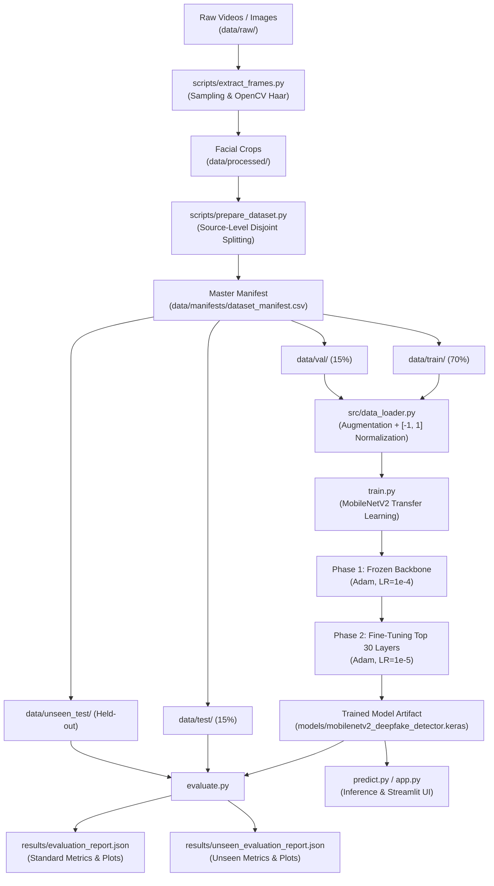

# Comprehensive Technical Documentation & Viva Reference Guide
## Deep Learning-Based Deepfake Detection Under Unseen Manipulation Techniques Using TensorFlow and Python

---

## 1. Project Overview
This project presents an end-to-end, production-grade deep learning system for facial deepfake detection. Implemented in Python 3 using TensorFlow 2.x, Keras, OpenCV, and Streamlit, the system leverages transfer learning with a pretrained MobileNetV2 backbone. It evaluates model generalization across two distinct paradigms:
1. **Standard Evaluation:** Detecting manipulated video frames from held-out video sources created using manipulation methods encountered during training.
2. **Unseen Manipulation Evaluation:** Assessing whether the detector can generalize to manipulations generated by novel, held-out manipulation families not present in the training distribution.

The pipeline includes automated facial detection, bounding box margin padding, leakage-free source-level dataset splitting, dual-phase training (frozen head training followed by fine-tuning), comprehensive metric calculation (Accuracy, Precision, Recall, Specificity, F1-Score, ROC-AUC), and an interactive Streamlit graphical web application.

---

## 2. Problem Statement
The democratization of generative artificial intelligence and synthetic media frameworks has made hyper-realistic facial manipulation accessible to non-experts. Deepfakes pose acute threats to democratic discourse, financial security, judicial evidence integrity, and personal privacy.

While convolutional neural networks (CNNs) can achieve over 95% accuracy when evaluated on the specific manipulation algorithms they were trained on, their performance often plummets significantly when tested on **unseen manipulation techniques** (e.g., training on Face2Face and evaluating on NeuralTextures or diffusion-based synthesis). This vulnerability occurs because deep neural networks tend to overfit to low-level, method-specific generative fingerprints (such as upsampling artifacts or color blend boundaries) rather than learning invariant representations of authentic biological tissue and lighting physics.

---

## 3. Motivation and Real-World Applications
1. **Journalism and Media Verification:** Equipping newsrooms with verification tooling to filter manipulated user-generated video content.
2. **Biometric Identity Authentication:** Defending remote Know-Your-Customer (KYC) onboarding against spoofing and deepfake presentation attacks.
3. **Legal Forensics:** Providing investigative tooling for digital evidence verification in criminal and civil litigation.
4. **Social Media Trust & Safety:** Automated content screening pipelines to flag non-consensual synthetic imagery.

---

## 4. Research Objectives
- **Objective 1:** Construct a lightweight, CPU-compatible facial feature extraction pipeline using MobileNetV2 pretrained on ImageNet.
- **Objective 2:** Establish a leakage-free dataset partitioning protocol grouped by source video identifier, eliminating frame-level identity overlap.
- **Objective 3:** Implement an OpenCV-based face detection pipeline that handles facial cropping, margin padding, and image corruptions gracefully.
- **Objective 4:** Provide a dual-evaluation framework separating standard testing from genuine unseen manipulation testing.
- **Objective 5:** Develop a responsive, non-crashing Streamlit user interface suitable for academic demonstrations.

---

## 5. Scope and Boundaries
- **In Scope:** Static facial image and video frame analysis, binary classification (REAL vs. FAKE), MobileNetV2 transfer learning, CPU-friendly laptop execution, source-level leakage prevention, evaluation plotting, and interactive inference.
- **Out of Scope:** Multi-modal audio-visual synchronization, temporal 3D recurrent neural networks (LSTM/Transformer video sequence modeling), and adversarial attack generation.

---

## 6. What Deepfakes Are
A **deepfake** is synthetic media in which a person's visual likeness or voice is altered or generated using deep neural networks. The term originated in 2017 as a portmanteau of "deep learning" and "fake." Modern deepfakes span four primary categories:
1. **Entire Face Synthesis:** Generating non-existent, photorealistic faces from random noise vectors using Generative Adversarial Networks (e.g., StyleGAN) or Diffusion Models.
2. **Face Swapping (Identity Replacement):** Replacing the facial region of a target video with the face of a source subject while preserving the target's head pose, lighting, and expressions.
3. **Facial Reenactment (Expression Transfer):** Modifying the facial expressions, gaze, and mouth movements of a target subject to match an actor's movements in real time.
4. **Facial Attribute Editing:** Selectively modifying facial attributes such as age, hair color, skin tone, or emotional expression.

---

## 7. How Facial Manipulation Techniques Work (High Level)
1. **Autoencoder-Based Face Swapping (e.g., DeepFaceLab, FakeApp):**
   - Employs a shared encoder with two dedicated decoders ($Decoder_A$ for Person A, $Decoder_B$ for Person B).
   - The shared encoder extracts invariant facial features (pose, lighting, expression).
   - Passing Person B's latent features through $Decoder_A$ reconstructs Person B's face with Person A's identity.
2. **3D Morphable Model (3DMM) Reenactment (e.g., Face2Face):**
   - Reconstructs dense 3D facial geometry from monocular video.
   - Deforms the mesh to match source actor tracking points and renders synthetic mouth and eye regions back onto the target frame.
3. **Neural Textures (e.g., Deferred Neural Rendering):**
   - Utilizes learned facial texture feature maps evaluated through a neural renderer instead of traditional graphic shaders.
4. **Diffusion-Based Synthesis (e.g., Latent Diffusion, Stable Diffusion Inpainting):**
   - Iteratively denoises Gaussian noise conditioned on text prompts or source reference latent tokens.

---

## 8. Why Unseen Manipulation Detection is Difficult
1. **Superficial Artifact Exploitation:** When trained on a specific manipulation algorithm, CNNs learn high-frequency interpolation artifacts (such as checkerboard artifacts from transposed convolutions) that are unique to that algorithm's upsampling layers.
2. **Domain Shift:** Different generation families use distinct loss functions, blending boundaries, color spaces, and resolution pipelines.
3. **Compression Resilience:** Social media compression (e.g., H.264/H.265 at high quantization parameters) destroys high-frequency artifacts, eliminating the cues the model relied on.

---

## 9. Training, Validation, Standard Testing, and Unseen Testing
- **Training Set (70%):** Utilized by backpropagation to optimize model weights. Contains authentic samples and *known* manipulation techniques.
- **Validation Set (15%):** Used for hyperparameter tuning, early stopping, and learning-rate reduction. Drawn from disjoint source videos of the *known* manipulation techniques.
- **Standard Test Set (15%):** Evaluates in-distribution generalization. Features disjoint source videos of the *known* manipulation techniques that were never seen during training or validation.
- **Unseen Manipulation Test Set:** Evaluates out-of-distribution generalization. Composed of authentic samples and manipulated samples generated by an *entirely excluded manipulation family* (e.g., NeuralTextures when the model was trained on Deepfakes and Face2Face).

---

## 10. Dataset Selection & Access Instructions
See `DATASET_GUIDE.md` for full instructions. In summary:
1. **KaggleHub Programmatic Downloader:** Automated via `scripts/download_dataset.py`.
2. **Kaggle DFDC Sample (4 GB):** Contains 400 sample videos and `metadata.json`.
3. **FaceForensics++ (40 GB):** Academic dataset with distinct manipulation categories (DF, F2F, FS, NT).
4. **Synthetic Demo Dataset (5 MB):** Pre-generated via `scripts/create_demo_data.py` for immediate pipeline testing.

---

## 11. Complete Pipeline Architecture (Mermaid Diagram)



---

## 12. Video-to-Frame Extraction
Implemented in `scripts/extract_frames.py`:
- Videos are decoded using `cv2.VideoCapture`.
- Frames are sampled at interval $K$ (`FRAME_INTERVAL = 15`) to eliminate redundant consecutive frames.
- A configurable cap (`FRAMES_PER_VIDEO = 10`) restricts disk usage and CPU load.
- Frames are tagged with their source video filename as a persistent identifier.

---

## 13. Facial Cropping and Preprocessing
Implemented in `src/preprocessing.py`:
1. **Detection:** Prominent face detected via OpenCV Haar Cascade (`haarcascade_frontalface_default.xml`).
2. **Padding Margin:** Configured with `FACE_PADDING_RATIO = 0.15` to ensure facial borders, jawline, and forehead boundaries (where blending seams often occur) are preserved:
   $$x_1 = \max(0, f_x - \text{pad}_x), \quad y_1 = \max(0, f_y - \text{pad}_y)$$
   $$x_2 = \min(W, f_x + f_w + \text{pad}_x), \quad y_2 = \min(H, f_y + f_h + \text{pad}_y)$$
3. **Interpolation:** Resized to $224 \times 224 \times 3$ via high-quality bicubic interpolation.
4. **Fallback:** If no face is detected, the entire frame is resized and a boolean flag `face_detected=False` is logged.

---

## 14. Normalization and Augmentation
- **Normalization:** MobileNetV2 requires float32 values normalized to $[-1.0, 1.0]$:
  $$x_{\text{norm}} = \frac{x}{127.5} - 1.0$$
- **Data Augmentation:** Applied **strictly** to training data:
  - Random Horizontal Flip
  - Random Rotation ($\pm 10\%$)
  - Random Zoom ($\pm 10\%$)
  - Random Contrast Adjustment ($\pm 10\%$)
  *Augmentation is never applied during validation, testing, or inference.*

---

## 15. Preventing Data Leakage
Data leakage occurs when information from outside the training dataset influences the model.
- **The Pitfall:** Frame-level random shuffling. If Frame 1 of Video X is in training and Frame 2 of Video X is in testing, the model achieves artificial 99% accuracy by memorizing Person X's identity and background lighting.
- **Our Implementation:** All partitioning operates at the **source video identifier** level:
  $$\text{Sources}_{\text{train}} \cap \text{Sources}_{\text{val}} = \emptyset$$
  $$\text{Sources}_{\text{train}} \cap \text{Sources}_{\text{test}} = \emptyset$$
  `scripts/validate_dataset.py` mathematically checks for zero intersection before training is permitted.

---

## 16. Transfer Learning from First Principles
Transfer learning reuses knowledge gained from solving one problem and applies it to a related problem. Training a deep CNN from scratch requires millions of labeled images and days of GPU compute. By utilizing MobileNetV2 pretrained on ImageNet (1.4 million images, 1,000 classes), early and intermediate layers already encode universal visual primitives (edges, gradients, textures). We freeze these layers and train only the task-specific classification head.

---

## 17. Why MobileNetV2 Was Selected
1. **Computational Efficiency:** 3.5 million parameters compared to 25 million for ResNet-50 and 138 million for VGG-16.
2. **Inverted Residuals with Linear Bottlenecks:** Memory footprint is minimized by expanding to higher dimensions only inside the residual block and contracting to lower-dimensional linear bottlenecks.
3. **Depthwise Separable Convolutions:** Splits standard convolution into a $3 \times 3$ depthwise spatial filter and a $1 \times 1$ pointwise projection, reducing computation by 8 to 9 times:
   $$\text{Computational Reduction} \approx \frac{1}{N} + \frac{1}{D_k^2} \approx \frac{1}{9}$$
4. **CPU Usability:** Executes inference in milliseconds on standard laptop CPUs.

---

## 18. Model Architecture Details
```
Input: (224, 224, 3) Normalized [-1.0, 1.0]
  │
MobileNetV2 Backbone (154 layers, ImageNet weights, include_top=False)
  │
GlobalAveragePooling2D (Reduces 7x7x1280 feature maps to 1280-dim vector)
  │
Dense Layer (128 units, ReLU activation, L2 regularization=1e-4)
  │
BatchNormalization
  │
Dropout Layer (Rate = 0.35)
  │
Dense Output Layer (1 unit, Sigmoid activation)
```

---

## 19. Sigmoid Activation Function
The sigmoid function maps any real-valued number into the interval $(0, 1)$:

$$\sigma(z) = \frac{1}{1 + e^{-z}}$$

Where:
- $z$ is the logit (unscaled linear combination of incoming weights and biases).
- When $z \to +\infty$, $\sigma(z) \to 1$ (Manipulated / FAKE).
- When $z \to -\infty$, $\sigma(z) \to 0$ (Authentic / REAL).
- At $z = 0$, $\sigma(z) = 0.50$ (Decision boundary).

---

## 20. Binary Cross-Entropy Loss Function
Binary Cross-Entropy (Log Loss) measures performance where output is a probability value between 0 and 1:

$$\mathcal{L}_{\text{BCE}}(y, \hat{y}) = - \frac{1}{N} \sum_{i=1}^{N} \left[ y_i \log(\hat{y}_i) + (1 - y_i) \log(1 - \hat{y}_i) \right]$$

Where:
- $N$ is batch size.
- $y_i \in \{0, 1\}$ is ground truth (0 = REAL, 1 = FAKE).
- $\hat{y}_i = \sigma(z_i)$ is model predicted probability.
- If $y_i = 1$, loss is $-\log(\hat{y}_i)$. As $\hat{y}_i \to 1$, loss $\to 0$; as $\hat{y}_i \to 0$, loss $\to +\infty$.
- If $y_i = 0$, loss is $-\log(1 - \hat{y}_i)$. As $\hat{y}_i \to 0$, loss $\to 0$; as $\hat{y}_i \to 1$, loss $\to +\infty$.

---

## 21. Adam Optimizer
Adam (Adaptive Moment Estimation) combines the advantages of AdaGrad and RMSProp:

$$m_t = \beta_1 m_{t-1} + (1 - \beta_1) g_t \quad (\text{1st moment estimate - Mean})$$
$$v_t = \beta_2 v_{t-1} + (1 - \beta_2) g_t^2 \quad (\text{2nd moment estimate - Uncentered variance})$$

Bias-corrected moments:
$$\hat{m}_t = \frac{m_t}{1 - \beta_1^t}, \quad \hat{v}_t = \frac{v_t}{1 - \beta_2^t}$$

Weight update:
$$\theta_{t+1} = \theta_t - \frac{\alpha}{\sqrt{\hat{v}_t} + \epsilon} \hat{m}_t$$

Where $\alpha$ is learning rate ($10^{-4}$ for Phase 1, $10^{-5}$ for Phase 2), $\beta_1 = 0.9$, $\beta_2 = 0.999$, $\epsilon = 10^{-7}$.

---

## 22. Backpropagation & Model Training
During backpropagation, gradients of the BCE loss with respect to trainable parameters are computed via the chain rule:

$$\frac{\partial \mathcal{L}}{\partial w_j} = \frac{\partial \mathcal{L}}{\partial \hat{y}} \cdot \frac{\partial \hat{y}}{\partial z} \cdot \frac{\partial z}{\partial w_j}$$

Because $\frac{\partial \sigma(z)}{\partial z} = \sigma(z)(1 - \sigma(z))$, the derivative simplifies elegantly to:

$$\frac{\partial \mathcal{L}}{\partial z} = \hat{y} - y$$

---

## 23. Early Stopping & Best-Model Checkpointing
1. **EarlyStopping Callback:** Monitors validation loss (`val_loss`) with patience $P=5$. If validation loss fails to improve for 5 consecutive epochs, training terminates to prevent overfitting.
2. **ModelCheckpoint Callback:** Saves model weights only when validation loss reaches a new global minimum, ensuring that sub-optimal weights from overfitted epochs are discarded.

---

## 24. Fine-Tuning
In Phase 2, the top 30 convolutional layers of the MobileNetV2 backbone are unfrozen. A lower learning rate ($\alpha = 10^{-5}$) is applied to gently adapt high-level feature filters to subtle facial artifacts without disrupting low-level primitive filters.

---

## 25. Evaluation Metrics & Mathematical Formulas

### Accuracy
$$\text{Accuracy} = \frac{\text{TP} + \text{TN}}{\text{TP} + \text{TN} + \text{FP} + \text{FN}}$$

### Precision (Positive Predictive Value)
$$\text{Precision} = \frac{\text{TP}}{\text{TP} + \text{FP}}$$

### Recall (Sensitivity / True Positive Rate)
$$\text{Recall} = \frac{\text{TP}}{\text{TP} + \text{FN}}$$

### Specificity (True Negative Rate)
$$\text{Specificity} = \frac{\text{TN}}{\text{TN} + \text{FP}}$$

### F1-Score (Harmonic Mean of Precision and Recall)
$$\text{F1-Score} = 2 \cdot \frac{\text{Precision} \cdot \text{Recall}}{\text{Precision} + \text{Recall}} = \frac{2\text{TP}}{2\text{TP} + \text{FP} + \text{FN}}$$

### ROC-AUC (Area Under the Receiver Operating Characteristic Curve)
$$\text{AUC} = \int_{0}^{1} \text{TPR}(\text{FPR}) \, d(\text{FPR})$$
Measures the probability that the classifier ranks a randomly chosen positive sample (FAKE) higher than a randomly chosen negative sample (REAL).

---

## 26. Confusion Matrix Interpretation
| | Predicted REAL | Predicted FAKE |
| :--- | :--- | :--- |
| **Actual REAL** | **True Negative (TN):** Authentic image correctly identified as authentic. | **False Positive (FP):** Authentic image falsely accused of being fake (Type I error). |
| **Actual FAKE** | **False Negative (FN):** Manipulated image missed and classified as authentic (Type II error). | **True Positive (TP):** Manipulated image correctly detected as fake. |

---

## 27. Standard vs. Unseen-Manipulation Evaluation
- **Standard Evaluation:** Measures in-distribution generalization. Evaluates whether the model generalizes to new identities manipulated using the *same family of techniques*.
- **Unseen Manipulation Evaluation:** Measures out-of-distribution robustness. Evaluates whether the model's learned representation detects manipulations produced by an *entirely distinct generative model*.

---

## 28. Source Code Architecture & File-by-File Guide
- `config.py`: Single source of truth for paths, hyperparameters, seeds, and image dimensions.
- `src/preprocessing.py`: Image loading, integrity verification, OpenCV face detection, and normalization.
- `src/model.py`: MobileNetV2 architecture, layer freezing, fine-tuning setup, and model loading.
- `src/data_loader.py`: `tf.data.Dataset` pipelines with prefetching, batching, and training-only augmentation.
- `src/metrics.py`: Threshold-aware computation of Accuracy, Precision, Recall, Specificity, F1, and ROC-AUC.
- `src/visualization.py`: Headless Matplotlib generation of training curves, confusion matrices, and ROC plots.
- `src/utils.py`: Standardized logging, seed setting, formatting, and JSON helpers.
- `scripts/download_dataset.py`: KaggleHub programmatic downloader with automated storage drive redirection.
- `scripts/download_instructions.py`: Guide for manual dataset downloads and Kaggle API token setup.
- `scripts/extract_frames.py`: Video frame decoder and facial crop extractor.
- `scripts/prepare_dataset.py`: Source-level data partitioner and manifest generator.
- `scripts/validate_dataset.py`: Dataset auditor verifying image integrity and zero data leakage.
- `scripts/create_demo_data.py`: Synthetic placeholder data generator for functional testing.
- `train.py`: Two-phase training script with callbacks and plot generation.
- `evaluate.py`: Standard and unseen test evaluation script.
- `predict.py`: CLI inference tool for single images.
- `app.py`: Multi-tab Streamlit web application.
- `tests/`: 16 unit tests covering preprocessing, model architecture, data splitting, and inference.

---

## 29. Installation Instructions Across Platforms

### Windows (PowerShell)
```powershell
git clone <repo-url>
cd Deep_Learning_project
python -m venv .venv
.venv\Scripts\Activate.ps1
python -m pip install --upgrade pip
pip install -r requirements.txt
```

### Linux (Ubuntu/Debian)
```bash
sudo apt update && sudo apt install -y python3-venv python3-pip libgl1-mesa-glx
python3 -m venv .venv
source .venv/bin/activate
pip install --upgrade pip
pip install -r requirements.txt
```

### macOS (Apple Silicon / Intel)
```bash
python3 -m venv .venv
source .venv/bin/activate
pip install --upgrade pip
pip install -r requirements.txt
```

---

## 30. Step-by-Step End-to-End Workflow Commands

```bash
# 1. Run unit test suite
python -m pytest tests/ -v

# 2. Generate or download data
python scripts/create_demo_data.py   # (Or python scripts/download_dataset.py)

# 3. Validate dataset integrity and zero data leakage
python scripts/validate_dataset.py

# 4. Train the MobileNetV2 model
python train.py --epochs 3 --fine-tune-epochs 1

# 5. Evaluate on standard and unseen test sets
python evaluate.py

# 6. Predict a single image
python predict.py --image data/test/fake/demo_fake_test_00_f000.jpg

# 7. Launch the Streamlit web interface
streamlit run app.py
```

---

## 31. Common Errors and Troubleshooting
1. **ModuleNotFoundError: No module named 'cv2':**
   - Ensure you run inside the virtual environment: `pip install opencv-python`.
2. **Kaggle 401 Unauthorized:**
   - Place `kaggle.json` inside `~/.kaggle/` (Linux/Mac) or `C:\Users\<User>\.kaggle\` (Windows).
3. **Out of Disk Space during Download:**
   - Run `python scripts/download_dataset.py`. It automatically detects if C: has <25GB and redirects to D:\kagglehub_cache.
4. **DeprecationWarning for NumPy 2.x copy keyword:**
   - Harmless warning handled internally by TensorFlow and Keras.

---

## 32. CPU Optimization and Optional GPU Usage
- **CPU Optimization:** TensorFlow uses oneDNN optimizations. Batch size is set to 16 and image size to $224 \times 224$ to fit within 4–8 GB RAM.
- **GPU Usage:** If an NVIDIA GPU with CUDA/cuDNN is available, TensorFlow automatically detects it via `tf.config.list_physical_devices('GPU')`. No code modifications required.

---

## 33. Ethical and Privacy Considerations
- **Non-Consensual Imagery:** Synthetic media must never be created or distributed to defame, harass, or impersonate individuals without consent.
- **Due Process:** Automated classifiers exhibit non-zero error rates; a model prediction should never be used as sole evidence to penalize an individual.

---

## 34. Viva Voce Preparation: 25+ Questions & Detailed Answers

### Q1: What is the core research objective of this project?
**Answer:** To build a deep learning system that classifies facial images as REAL or FAKE and to evaluate whether a model trained on known manipulation techniques can generalize to unseen manipulation techniques.

### Q2: Why did you choose MobileNetV2 instead of ResNet or VGG?
**Answer:** MobileNetV2 has only ~3.5 million parameters and uses depthwise separable convolutions, making it 8–9x more computationally efficient. It runs smoothly on standard student laptop CPUs without requiring dedicated GPUs.

### Q3: What is data leakage, and how did you prevent it?
**Answer:** Data leakage occurs when test data informs the training process. In video datasets, consecutive frames share identical lighting and identity. If split randomly by frame, the model memorizes the person rather than manipulation artifacts. We split data strictly by **source video identifier**, ensuring all frames from a video exist in only one split.

### Q4: What is the mathematical definition of MobileNetV2 normalization?
**Answer:** MobileNetV2 scales uint8 pixel values $[0, 255]$ to float32 values in $[-1.0, 1.0]$ using $x_{\text{norm}} = (x / 127.5) - 1.0$.

### Q5: Why is the output layer a single unit with Sigmoid instead of two units with Softmax?
**Answer:** For binary classification, a single unit with sigmoid activation $\sigma(z) = \frac{1}{1 + e^{-z}}$ is mathematically equivalent to a 2-class softmax, but requires fewer parameters and pairs directly with binary cross-entropy loss.

### Q6: What does the output score represent?
**Answer:** It represents the raw sigmoid activation $P(y = 1 | x)$, reflecting the model's learned feature similarity to manipulated samples. It is not a calibrated Bayesian probability.

### Q7: What loss function did you use, and why?
**Answer:** Binary Cross-Entropy (BCE). It penalizes confident wrong predictions logarithmically: $\mathcal{L} = -[y \log(\hat{y}) + (1-y)\log(1-\hat{y})]$.

### Q8: What optimizer was chosen, and what are its hyperparameters?
**Answer:** The Adam optimizer with $\beta_1 = 0.9$, $\beta_2 = 0.999$, $\epsilon = 10^{-7}$. Learning rate was $10^{-4}$ for initial head training and $10^{-5}$ for fine-tuning.

### Q9: Why is fine-tuning performed with a lower learning rate?
**Answer:** To prevent catastrophic forgetting. A high learning rate would destroy the pretrained ImageNet feature representations in the backbone.

### Q10: What does the GlobalAveragePooling2D layer do?
**Answer:** It computes the spatial average across each feature map ($7 \times 7 \times 1280 \to 1 \times 1280$), reducing parameters and eliminating spatial positional sensitivity compared to flattening.

### Q11: What is the purpose of the Dropout layer?
**Answer:** It randomly zeroes out a fraction (35%) of neuron activations during training, forcing the network to learn redundant, co-adapted representations and reducing overfitting.

### Q12: Why is data augmentation applied only to the training set?
**Answer:** Augmentation artificially expands training diversity. Applying it during validation or testing would distort ground-truth images and produce misleading metrics.

### Q13: What is the difference between Precision and Recall?
**Answer:** Precision ($\frac{\text{TP}}{\text{TP} + \text{FP}}$) measures how many predicted fakes were actually fake. Recall ($\frac{\text{TP}}{\text{TP} + \text{FN}}$) measures how many actual fakes were successfully caught by the system.

### Q14: When is F1-Score preferred over Accuracy?
**Answer:** When datasets exhibit class imbalance. In an imbalanced dataset (e.g., 90% real, 10% fake), a trivial model predicting REAL always achieves 90% accuracy but has an F1-Score of 0.

### Q15: What does ROC-AUC measure?
**Answer:** The Area Under the Receiver Operating Characteristic Curve measures the classifier's ability to rank positive instances higher than negative instances across all possible classification thresholds.

### Q16: How does OpenCV face detection assist the pipeline?
**Answer:** Cropping the face removes extraneous background pixels (clothing, walls, furniture) that could provide spurious correlations, forcing the CNN to focus on facial artifacts.

### Q17: Why do you add padding around the detected face crop?
**Answer:** Deepfake blending artifacts frequently occur along the hairline, ears, and jawline boundary. Margin padding ($15\%$) ensures these critical boundary seams are not clipped out.

### Q18: What is an unseen manipulation technique?
**Answer:** A generative manipulation method (such as NeuralTextures or diffusion synthesis) that was never present in the training or validation splits.

### Q19: Why does performance degrade on unseen manipulations?
**Answer:** Classifiers overfit to generator-specific high-frequency artifacts (e.g., upsampling grids) rather than biological inconsistencies, failing when a new generator produces different artifact signatures.

### Q20: What is Early Stopping?
**Answer:** A regularization technique that terminates training when validation loss stops improving for a specified number of epochs (patience=5), restoring best weights.

### Q21: What is ReduceLROnPlateau?
**Answer:** A callback that scales the learning rate by factor $0.5$ when validation loss stagnates for 3 epochs, allowing fine-grained convergence in loss minima.

### Q22: What format are model weights saved in?
**Answer:** Native Keras v3 `.keras` zip archive containing architecture, weights, and optimizer state in a single portable file.

### Q23: Why do we inspect KaggleHub cache storage space?
**Answer:** Large datasets (22+ GB) can crash machines by filling the primary `C:\` drive. Our code detects free space and redirects cache to `D:\` automatically.

### Q24: Can this model detect audio deepfakes?
**Answer:** No. It is an image-based spatial convolutional neural network. Audio detection requires spectrogram acoustic modeling.

### Q25: Why is a deepfake prediction not absolute legal proof?
**Answer:** Neural networks are statistical function approximators susceptible to domain shift, compression artifacts, and false positives. Human expert verification is mandatory.

---

## 35. Glossary of Machine Learning Terms
- **Backpropagation:** Algorithm calculating gradients of loss with respect to parameters using the chain rule.
- **Convolutional Layer:** Layer applying learnable spatial filters to extract local feature patterns.
- **Data Leakage:** Unintentional sharing of information between training and evaluation splits.
- **Depthwise Separable Convolution:** Factored convolution dividing spatial filtering from channel combination.
- **Epoch:** One complete pass through the entire training dataset.
- **False Positive (FP):** Real image mistakenly classified as fake.
- **False Negative (FN):** Fake image mistakenly classified as real.
- **Overfitting:** When a model memorizes training noise and fails to generalize to unseen test data.
- **Sigmoid:** S-shaped activation function mapping real numbers to range $(0, 1)$.
- **Transfer Learning:** Applying knowledge from a source domain (ImageNet) to a target domain (Deepfake detection).

---

## 36. Verifiable Technical References
1. Sandler, M., Howard, A., Zhu, M., Zhmoginov, A., & Chen, L. C. (2018). *MobileNetV2: Inverted Residuals and Linear Bottlenecks*. CVPR. [https://arxiv.org/abs/1801.04381](https://arxiv.org/abs/1801.04381).
2. Rössler, A., Cozzolino, D., Verdoliva, L., Riess, C., Thies, J., & Nießner, M. (2019). *FaceForensics++: Learning to Detect Manipulated Facial Images*. ICCV. [https://arxiv.org/abs/1901.08971](https://arxiv.org/abs/1901.08971).
3. Dolhansky, B., et al. (2020). *The Deepfake Detection Challenge (DFDC) Dataset*. [https://arxiv.org/abs/2006.07397](https://arxiv.org/abs/2006.07397).
4. Kingma, D. P., & Ba, J. (2014). *Adam: A Method for Stochastic Optimization*. ICLR. [https://arxiv.org/abs/1412.6980](https://arxiv.org/abs/1412.6980).
5. Goodfellow, I., Bengio, Y., & Courville, A. (2016). *Deep Learning*. MIT Press. [https://www.deeplearningbook.org/](https://www.deeplearningbook.org/).
